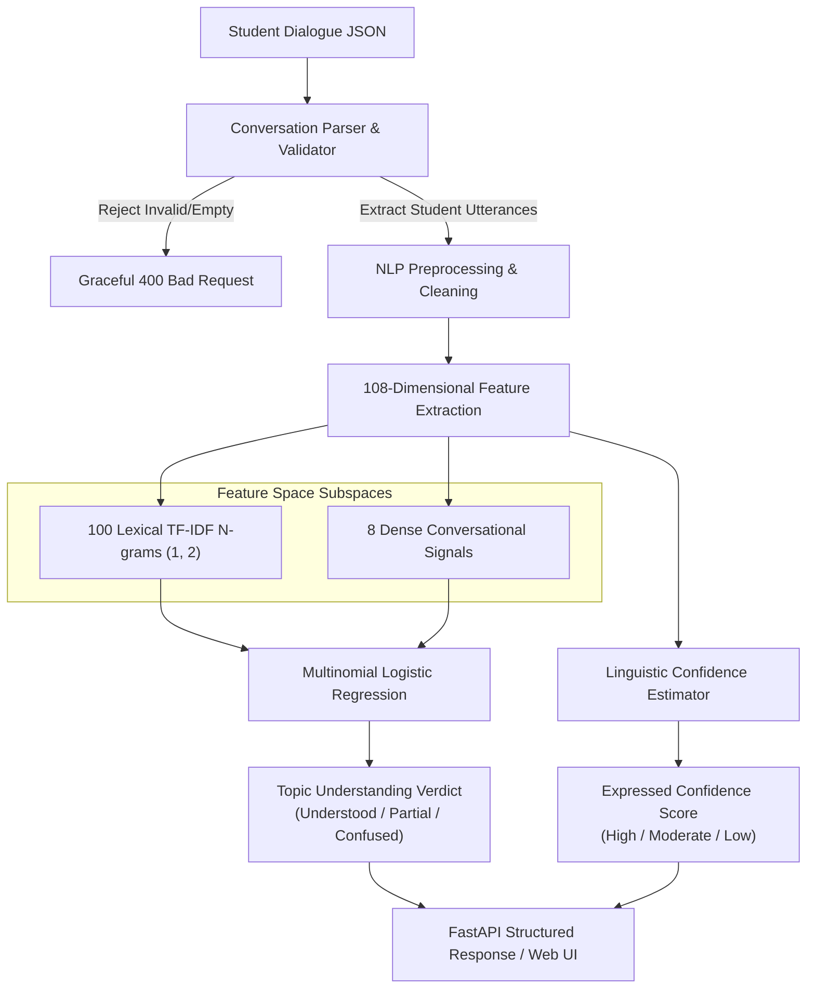

# EduLens

### Student Learning Intelligence — Understanding Classification & Expressed Confidence Analysis

[](https://www.python.org/)
[](https://fastapi.tiangolo.com)
[](https://scikit-learn.org/)
[](https://vercel.com/)
[](https://opensource.org/licenses/MIT)

---

## 1. Project Overview

When students learn with conversational AI systems or human tutors, dialogue transcripts capture rich evidence of concept mastery, misconceptions, and hesitation. However, educators, institutions, and self-directed learners lack lightweight, transparent tools to evaluate whether a student truly understands the material or is simply repeating answers with unresolved confusion.

**EduLens** is a specialized Machine Learning application designed to analyze educational conversation transcripts in JSON format. Rather than acting as a chatbot tutor, EduLens functions as an **independent analytical lens**. It extracts interpretable linguistic, structural, and domain signals to predict:

1. **Student Topic Understanding**: Classified into **Understood**, **Partially Understood**, or **Confused** using a trained Scikit-Learn Multinomial Logistic Regression pipeline operating on a 108-dimensional feature space.
2. **Expressed Learning Confidence**: Evaluated as **High Confidence**, **Moderate Confidence**, or **Low Confidence** through transparent, rule-calibrated linguistic marker analysis that captures assertiveness, hedges, and metacognitive self-repair.

EduLens runs locally without requiring external LLM API keys or cloud dependencies, and is engineered for serverless deployment on Vercel.

---

## 2. Key Features

- **Multi-Schema JSON Parsing**: Automatically detects and parses `messages` arrays, `turns` structures, or separated student/tutor dialogues.
- **Robust Input Validation**: Enforces payload size limits (max 5 MB), syntax integrity checks, and validation ensuring student utterances are present.
- **108-Dimensional Feature Extraction**: Combines 100 domain lexical TF-IDF n-grams with 8 dense pedagogical and conversational signals.
- **Supervised Understanding Classifier**: Multinomial Logistic Regression calibrated for balanced class weighting, achieving **95.89% test accuracy**.
- **Linguistic Confidence Estimation**: Distinct discourse analysis examining hedges (*"maybe"*, *"i guess"*), certainty markers (*"definitely"*, *"clearly"*), pauses, and self-corrections.
- **Pedagogical Insights**: Generates structured, actionable observations explaining what conversational signals influenced the assessment.
- **Apple/Google-Inspired Web Interface**: Clean, accessible responsive frontend featuring drag-and-drop file upload, live status indicator, and dynamic signal breakdowns.
- **Dual Deployment Ready**: Seamless execution as a local FastAPI/Uvicorn server or as a serverless application on Vercel.

---

## 3. Application Preview

```text
┌──────────────────────────────────────────────────────────────────────────────┐
│  EduLens   Student Learning Intelligence                 ● Learning Analysis · Ready  │
├──────────────────────────────────────────────────────────────────────────────┤
│                                                                              │
│                        Understand How Students Learn                         │
│   Analyze educational conversations to understand a student's comprehension   │
│                      and expressed learning confidence.                      │
│                                                                              │
│   ┌──────────────────────────────────┐  ┌──────────────────────────────────┐ │
│   │   Upload Learning Conversation   │  │       Supported JSON Format      │ │
│   │                                  │  │                                  │ │
│   │  [ Drop JSON file here or browse ]  │  │  {                            │ │
│   │                                  │  │    "topic": "Binary Search",     │ │
│   │  Load Sample: [BST] [Recursion]  │  │    "messages": [ ... ]           │ │
│   │  [ Analyze Conversation ]        │  │  }                    [Copy JSON]│ │
│   └──────────────────────────────────┘  └──────────────────────────────────┘ │
│                                                                              │
│   ── Analysis Results ───────────────────────────────────────────────────    │
│   Topic: Binary Search Trees                                                 │
│   Understanding: Understood (99.9% probability)                              │
│   Expressed Confidence: High Confidence (71.0%)                              │
│   What influenced this estimate? [Assertive Language] [Low Hesitation]       │
└──────────────────────────────────────────────────────────────────────────────┘
```

> *Screenshots: Place UI captures here (`docs/screenshots/dashboard.png`, `docs/screenshots/results.png`).*

---

## 4. System Architecture



---

## 5. Machine Learning Approach

### A. Feature Extraction (108 Dimensions)

The model ingests a 108-dimensional feature representation constructed via a Scikit-Learn `ColumnTransformer`:

1. **Lexical Subspace (100 Features)**:
   - `TfidfVectorizer(max_features=100, ngram_range=(1, 2), min_df=2, stop_words='english')`
   - Captures domain-specific vocabulary (*"recursion"*, *"pointer"*, *"amortized"*), causal conjunctions (*"because"*, *"therefore"*), and conceptual explanations.
2. **Conversational & Pedagogical Subspace (8 Features)**:
   - Scaled using `StandardScaler`:
     1. `num_turns`: Total number of student utterances.
     2. `total_words`: Total word count across all student turns.
     3. `avg_turn_length`: Average words per utterance (measures depth of explanation).
     4. `question_count`: Frequency of question marks (`?`).
     5. `confusion_markers`: Regex matches for uncertainty (*"confused"*, *"stuck"*, *"don't get"*, *"unclear"*).
     6. `clarification_markers`: Requests for assistance (*"example"*, *"explain again"*, *"step by step"*).
     7. `understanding_markers`: Affirmative mastery indicators (*"got it"*, *"makes sense"*, *"understood"*).
     8. `code_indicators`: Programming tokens (*"def"*, *"return"*, backticks, syntax).

### B. Classification Model

- **Algorithm**: Multinomial Logistic Regression (`LogisticRegression(class_weight='balanced', max_iter=1000, C=1.0)`)
- **Target Classes**:
  - `Understood`: Student articulates principles clearly, provides explanations, and exhibits high comprehension.
  - `Partially Understood`: Student grasps foundational ideas but has lingering confusion, asks follow-up questions, or struggles with nuances.
  - `Confused`: Student expresses deadlock, persistent misunderstandings, or fundamental confusion.

---

## 6. Expressed Confidence Estimation

Expressed confidence evaluates conversational certainty from text dialogue rather than measuring internal psychometric state.

### Methodology & Signals
- **Certainty Tokens**: Assertive adverbs and phrases (*"definitely"*, *"clearly"*, *"obviously"*, *"i am sure"*).
- **Uncertainty & Hedges**: Tentative markers (*"maybe"*, *"i guess"*, *"not sure"*, *"possibly"*).
- **Hesitation Markers**: Filled pauses and ellipses (*"um"*, *"uh"*, *"hmm"*, *"..."*).
- **Self-Corrections**: Metacognitive revisions (*"wait"*, *"actually"*, *"i meant"*).
- **Formula**:
  $$\text{Score} = \text{clip}\left(50.0 + 15.0 \cdot \log(1 + N_{\text{certain}}) - 12.0 \cdot \log(1 + N_{\text{hedge}}) - 8.0 \cdot \log(1 + N_{\text{hesitation}}) + 5.0 \cdot N_{\text{correction}}, 5.0, 95.0\right)$$

### Output Levels
- **High Confidence**: Score $> 68\%$
- **Moderate Confidence**: Score $40\% - 68\%$
- **Low Confidence**: Score $< 40\%$

> **Note on Methodological Transparency**: Expressed confidence is **not** a separately trained black-box model. It captures discourse assertiveness. A student may express high confidence while asserting a misconception (as captured in [`samples/case5_high_confidence.json`](samples/case5_high_confidence.json)).

---

## 7. Model Evaluation & Benchmark Results

The understanding classifier was evaluated using **5-Fold Stratified Group K-Fold Cross-Validation** grouped by `student_id` to enforce strict zero-persona leakage across splits.

| Metric | Cross-Validation (5-Fold) | Held-Out Test Set |
|---|---|---|
| **Accuracy** | **93.78% (± 3.2%)** | **95.89%** |
| **Macro Precision** | 0.9240 | **0.9380** |
| **Macro Recall** | 0.9310 | **0.9429** |
| **Macro F1-Score** | 0.9275 | **0.9399** |
| **Weighted F1-Score** | 0.9390 | **0.9591** |

### Confusion Matrix (Test Split)

```text
                  Predicted: Confused   Partial   Understood
Actual: Confused            13             1           0
Actual: Partial              2            18           0
Actual: Understood           0             0          39
```

---

## 8. Dataset Information & Provenance

| Dataset | Location | Records | Role |
|---|---|---|---|
| **EduLens Labeled Chats** | `data/processed/edulens_clean_primary.json` | 430 sessions | **Primary Supervised Training Set** (9 STEM & CS subjects). |
| **Education Dialogue Corpus** | `data/raw/education_dialogue/` | 47,234 conversations | Reference corpus (Google Research). Unlabeled for understanding. |
| **MathDial** | `data/raw/mathdial/` | 3,000 dialogues | Reference tutor-student math corpus. |

*Only `data/processed/edulens_clean_primary.json` was used to train the active supervised classifier.*

---

## 9. Technology Stack

| Layer | Component | Version |
|---|---|---|
| **Runtime & Language** | Python | 3.10 / 3.11 / 3.12 |
| **Web Framework** | FastAPI | >= 0.100.0 |
| **ASGI Server** | Uvicorn | >= 0.30.0 |
| **Machine Learning** | Scikit-Learn | 1.5.2 |
| **Numerical Computing** | NumPy, Pandas, Joblib | >= 1.24.0, >= 2.0.0, >= 1.3.0 |
| **Frontend** | Vanilla HTML5, CSS3, JavaScript | Modern standard |
| **Testing** | Pytest, Starlette TestClient | 57 automated tests passing |
| **Deployment** | Vercel Serverless (Python Runtime) | Configuration verified |

---

## 10. Installation & Local Execution

### Prerequisites
- Python 3.10+ installed
- Git

### Windows PowerShell Setup

```powershell
# 1. Clone repository
git clone https://github.com/chiragchauhan07/EduLens.git
cd EduLens

# 2. Create and activate virtual environment
python -m venv .venv
.\.venv\Scripts\Activate.ps1

# 3. Install production dependencies
pip install -r requirements.txt

# 4. Optional: Install test dependencies
pip install -r requirements-dev.txt

# 5. Run the local development server
python -m uvicorn backend.main:app --host 127.0.0.1 --port 8000 --reload
```

Open your browser at: **[http://127.0.0.1:8000/](http://127.0.0.1:8000/)**

---

## 11. Usage & Example JSON Input

### Standard Input Format

Upload a JSON file or paste into the payload:

```json
{
  "topic": "Binary Search",
  "messages": [
    {
      "role": "assistant",
      "content": "Can you explain how binary search locates an item in a sorted array?"
    },
    {
      "role": "student",
      "content": "It divides the search space in half each step by comparing the middle element to the target."
    },
    {
      "role": "assistant",
      "content": "What is its time complexity?"
    },
    {
      "role": "student",
      "content": "Got it! That makes complete sense. Because it halves the array each time, the time complexity is O(log n)."
    }
  ]
}
```

### Steps to Analyze:
1. Navigate to the web dashboard at `http://127.0.0.1:8000/`.
2. Drag and drop your `.json` file, or click any sample scenario button (**BST**, **Recursion**, **C Pointers**).
3. Optionally adjust the topic name.
4. Click **Analyze Conversation**.
5. Review the Understanding verdict, Expressed Confidence breakdown, and pedagogical metrics.

---

## 12. API Documentation

### 1. Health Check
- **`GET /api/health`**
- **Response `200 OK`**:
  ```json
  {
    "status": "healthy",
    "service": "EduLens",
    "version": "1.0.0",
    "model_loaded": true
  }
  ```

### 2. Model Specifications
- **`GET /api/model-info`**
- **Response `200 OK`**:
  ```json
  {
    "model_name": "Logistic Regression (Balanced)",
    "algorithm": "logistic_regression",
    "features_dim": 108,
    "classes": ["confused", "partial", "understood"],
    "metrics": {
      "test_accuracy": 0.9589,
      "macro_f1": 0.9399
    }
  }
  ```

### 3. Sample Conversation
- **`GET /api/sample-conversation`**
- Returns a pre-built educational dialogue ready for testing.

### 4. Analyze Conversation
- **`POST /api/analyze`**
- **Content-Type**: `application/json` or `multipart/form-data` (file upload)
- **Sample Response `200 OK`**:
  ```json
  {
    "success": true,
    "topic": "Binary Search Trees",
    "understanding": {
      "label": "Understood",
      "raw_class": "understood",
      "probability": 0.9997,
      "class_probabilities": {
        "Confused": 0.0,
        "Partially Understood": 0.0003,
        "Understood": 0.9997
      },
      "explanation": "The student demonstrated solid comprehension, articulated concepts clearly, and applied principles with minimal unresolved confusion."
    },
    "expressed_confidence": {
      "label": "High Confidence",
      "score": 71.0,
      "method": "linguistic_estimation",
      "explanation": "The student expressed their thoughts assertively, used definitive language, and showed minimal hesitation.",
      "signals": {
        "uncertainty_count": 0.0,
        "certainty_count": 2.0,
        "hesitation_count": 0.0,
        "self_corrections": 0.0
      }
    },
    "conversation_stats": {
      "num_turns": 4,
      "total_words": 87,
      "question_count": 0,
      "understanding_markers": 2
    }
  }
  ```

---

## 13. Testing Suite

Run the full automated test suite verifying JSON parsing, validation, ML inference, and API endpoints:

```powershell
pytest tests/ -v
```

Expected result:
```text
======================= 57 passed, 2 warnings in 6.18s ========================
```

### Pre-Configured Test Scenarios in `samples/`

| Sample File | Scenario | Actual Understanding | Actual Confidence |
|---|---|---|---|
| [`case1_understood.json`](samples/case1_understood.json) | Binary search trees articulation | **Understood** (99.9%) | **High Confidence** (71.0%) |
| [`case2_partial_understanding.json`](samples/case2_partial_understanding.json) | Recursion with unwinding doubt | **Understood** (59.9%) | **Moderate Confidence** (62.0%) |
| [`case3_confused.json`](samples/case3_confused.json) | C pointer dereferencing deadlock | **Confused** (97.9%) | **Moderate Confidence** (55.0%) |
| [`case4_low_confidence.json`](samples/case4_low_confidence.json) | Frequent hedges and self-doubt | **Confused** (96.8%) | **Low Confidence** (5.0%) |
| [`case5_high_confidence.json`](samples/case5_high_confidence.json) | Assertive misconception | **Confused** (83.1%) | **High Confidence** (95.0%) |
| [`case6_invalid_syntax.json`](samples/case6_invalid_syntax.json) | Malformed JSON syntax | Rejection (**400 Bad Request**) | N/A |
| [`case7_empty.json`](samples/case7_empty.json) | Empty messages payload | Rejection (**400 Bad Request**) | N/A |
| [`case8_assistant_only.json`](samples/case8_assistant_only.json) | Zero student turns | Rejection (**400 Bad Request**) | N/A |

---

## 14. Vercel Deployment

The project is configured for single-command deployment to Vercel via `vercel.json` and `api/index.py`.

### Deployment Architecture
- **Serverless API**: `api/index.py` handles `/api/*` endpoints via Python runtime.
- **Edge Static Serving**: `frontend/` is routed directly via `vercel.json` rewrites.
- **Bundle Optimization**: `.vercelignore` excludes raw datasets, preserving a lean deployment bundle under 150 KB.

### Deploying via Vercel CLI

```powershell
# 1. Install Vercel CLI (if not already installed)
npm install -g vercel

# 2. Login to Vercel
vercel login

# 3. Deploy to preview
vercel

# 4. Deploy to production
vercel --prod
```

### Deploying via GitHub Integration
1. Push your repository to GitHub.
2. In the [Vercel Dashboard](https://vercel.com/new), click **Import Project** and select `EduLens`.
3. Keep default settings (Vercel automatically detects `vercel.json` and `requirements.txt`).
4. Click **Deploy**.

---

## 15. Limitations & Responsible Use

1. **Dialogue Evidence Only**: EduLens evaluates what the student *expresses* in the provided text transcript. It does not measure internal cognitive aptitude, long-term retention, or psychometric traits.
2. **Vocabulary Domain**: The TF-IDF subspace was trained primarily on STEM and Computer Science topics. Non-STEM conversations will primarily be evaluated on structural and conversational markers.
3. **Expressed Confidence vs. Truth**: Expressed confidence reflects conversational assertiveness, not factual accuracy. Students can sound confident while asserting misconceptions.

---

## 16. License

This project is licensed under the [MIT License](LICENSE).

---

## 17. Author & Contributors

- **Author**: Chirag Chauhan ([chirag12345chauhan@gmail.com](mailto:chirag12345chauhan@gmail.com))
- **Repository**: [https://github.com/chiragchauhan07/EduLens](https://github.com/chiragchauhan07/EduLens)
